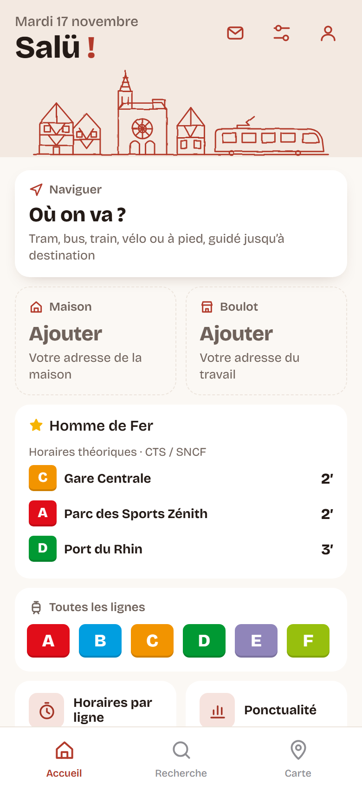
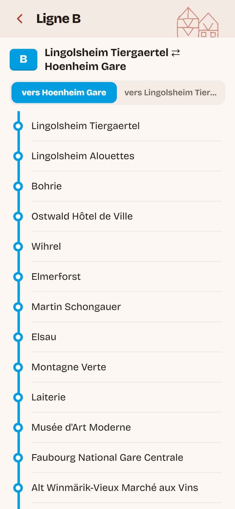
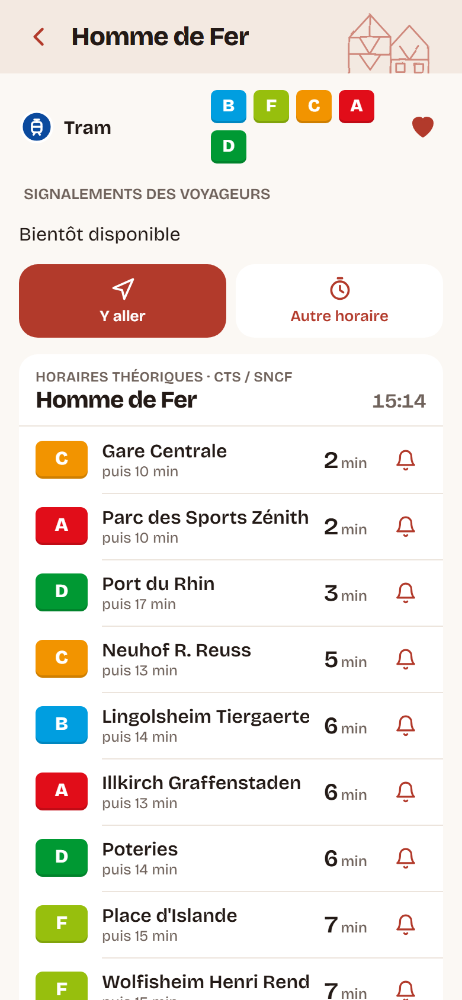
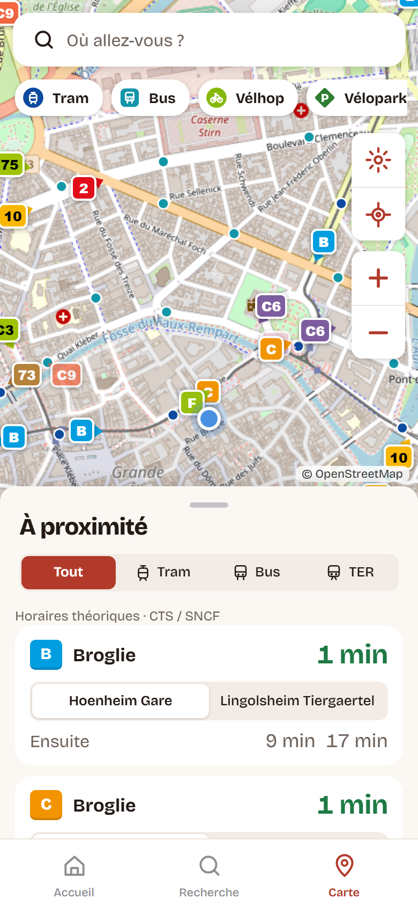
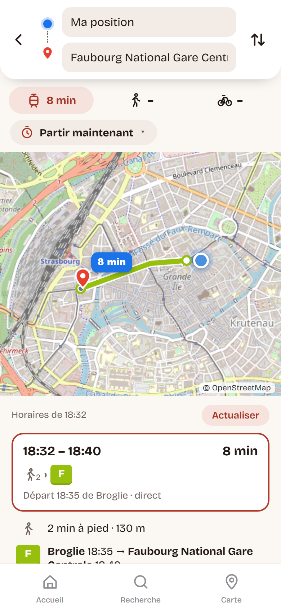

# Kumm

**Les transports de Strasbourg dans votre poche : horaires, carte, lignes et itinéraires.**
Kumm (« viens » en alsacien) est une application Android indépendante pour le réseau CTS et les trains TER de l'Eurométropole de Strasbourg. Elle fonctionne **sans compte et sans serveur** : les horaires officiels sont enregistrés sur votre téléphone et restent consultables hors connexion.

[](https://github.com/Qoats/Kumm/releases/latest)
[](LICENSE)

<p align="center">
  
  
  
  
  
</p>

> **Projet indépendant et non officiel.** Kumm n'est ni édité, ni approuvé, ni affilié à la CTS, à la SNCF ni à l'Eurométropole de Strasbourg.

## Ce que vous pouvez faire

- **Voir les prochains passages** de tous les trams, bus et TER, à chaque arrêt, avec les horaires officiels.
- **Suivre une ligne** : tous ses arrêts dans l'ordre, dans les deux sens, avec les terminus.
- **Explorer la carte** : arrêts de tram, de bus et gares, parkings relais, et les véhicules en circulation, qui avancent sur leur tracé.
- **Préparer un trajet** : adresse, arrêt ou lieu, puis itinéraire en transports avec correspondances, à pied ou à vélo.
- **Garder vos arrêts favoris** sous la main, avec leurs prochains passages sur l'accueil, et enregistrer « Maison » et « Travail ».
- **Utiliser des widgets** sur l'écran d'accueil d'Android (arrêt favori, trajet, arrêt proche, raccourcis).
- **Personnaliser l'apparence** : quatre thèmes (dont un contraste élevé et un thème sombre) et cinq couleurs.

## Installer l'application (Android)

1. Ouvrez la [dernière version](https://github.com/Qoats/Kumm/releases/latest) depuis votre téléphone et téléchargez **`kumm.apk`**.
2. Ouvrez le fichier. Android vous demandera d'autoriser l'installation depuis cette source : acceptez pour cette fois seulement.
3. Les horaires théoriques CTS sont inclus et disponibles dès le premier lancement hors connexion. Une connexion permet de télécharger les horaires TER et d’actualiser les données.

> **Vous avez déjà une ancienne version (0.52.x) ?** La version 0.53 est signée avec une nouvelle clé : Android refuse de la poser par-dessus. Désinstallez l'ancienne version d'abord ; vos favoris enregistrés sur le téléphone seront perdus. Les versions suivantes se mettront à jour normalement.

**Mises à jour.** Quand une nouvelle version est publiée sur GitHub, Kumm vous la propose au démarrage : *Télécharger et installer*, *Plus tard* ou *Ignorer cette version*. Rien n'est téléchargé sans votre accord, et le fichier est vérifié (empreinte et signature) avant l'installation.

Une version web existe aussi sur [app.kumm.fr](https://app.kumm.fr) : mêmes calculs dans le navigateur, mêmes horaires ouverts, sans compte ni serveur.

## Comment ça marche

Kumm utilise les **données ouvertes officielles** de la CTS (trams et bus) et de la SNCF (TER). Les prochains départs sont recalculés toutes les 30 secondes au premier plan. Quand Internet est disponible, l’application vérifie en arrière-plan si les fichiers ont changé, avec un intervalle de 20 minutes entre les contrôles réussis. Android peut différer les tâches quand l’application est en arrière-plan.

Deux choses à savoir :

- **Les horaires sont théoriques**, pas en temps réel : retards, suppressions et perturbations ne sont pas connus de l'application.
- **La position d'un véhicule sur la carte est estimée** à partir de ses horaires et de son parcours. Ce n'est pas un GPS.

Les fonctions qui exigent vraiment le temps réel (informations trafic, ponctualité mesurée, signalements, disponibilité des vélos Vélhop) ne sont pas disponibles pour l'instant et affichent « Bientôt disponible ».

## Vie privée

- Aucun compte, aucune publicité, et aucun serveur Kumm : l'application n'envoie rien à un serveur du projet.
- Vos favoris et vos réglages restent sur votre téléphone.
- La recherche d’adresses dans l’Eurométropole se fait sur l’appareil. Si aucune adresse locale ne correspond et qu’une connexion est disponible, l’application peut consulter la Base Adresse Nationale. Elle contacte aussi les autres sources publiques au besoin pour les horaires, les cheminements et les mises à jour.
- Votre position sert à afficher les arrêts proches sur l'appareil. Pour calculer un cheminement à pied ou à vélo, les coordonnées du trajet sont envoyées au service de routage OpenStreetMap.

## Données et licences

| Donnée | Source |
|---|---|
| Arrêts, lignes et horaires CTS | CTS / Eurométropole de Strasbourg, données ouvertes sur [transport.data.gouv.fr](https://transport.data.gouv.fr/datasets/donnees-theoriques-gtfs-et-temps-reel-siri-lite-du-reseau-cts), [Licence Ouverte 2.0](https://www.etalab.gouv.fr/licence-ouverte-open-licence/) |
| Gares et horaires TER | SNCF, données ouvertes sur [transport.data.gouv.fr](https://transport.data.gouv.fr/datasets/horaires-sncf) (ODbL) |
| Fonds de carte, tracés des lignes, voies ferrées, cheminements | © contributeurs OpenStreetMap ([ODbL](https://www.openstreetmap.org/copyright)) |
| Adresses | [Référentiel adresse de l’Eurométropole de Strasbourg](https://data.strasbourg.eu/explore/dataset/referentiel_adresse_eurometrostras/information/) (Licence Ouverte 2.0) et Base Adresse Nationale, via la Géoplateforme de l’IGN |
| Parkings relais | Eurométropole de Strasbourg, open data |

Le code de Kumm est publié sous [licence MIT](LICENSE). Les données gardent les conditions de leurs producteurs.

## Contribuer et développer

Le projet est écrit en TypeScript (interface web empaquetée avec Capacitor pour Android) ; un serveur Node optionnel sert la version web.

```sh
npm ci
npm run dev        # interface web sur http://localhost:5173
npm test           # tests
```

- Architecture Android autonome, tests et recette : [`docs/ANDROID-AUTONOME.md`](docs/ANDROID-AUTONOME.md)
- Hébergement sur GitHub Pages (kumm.fr ici, app.kumm.fr dans le dépôt kumm-app), DNS et données ouvertes : [`docs/GITHUB-PAGES.md`](docs/GITHUB-PAGES.md)
- Notes de développement, données et exploitation du serveur : [`docs/DEVELOPPEMENT.md`](docs/DEVELOPPEMENT.md)
- Politique de confidentialité : [`docs/POLITIQUE-CONFIDENTIALITE.md`](docs/POLITIQUE-CONFIDENTIALITE.md)

Les captures d'écran de ce README se régénèrent avec `node scripts/capture-screenshots.mjs`.

Les contributions sont les bienvenues : ouvrez une *issue* pour proposer une amélioration ou signaler un problème (n'y publiez jamais de jeton ou de secret).
